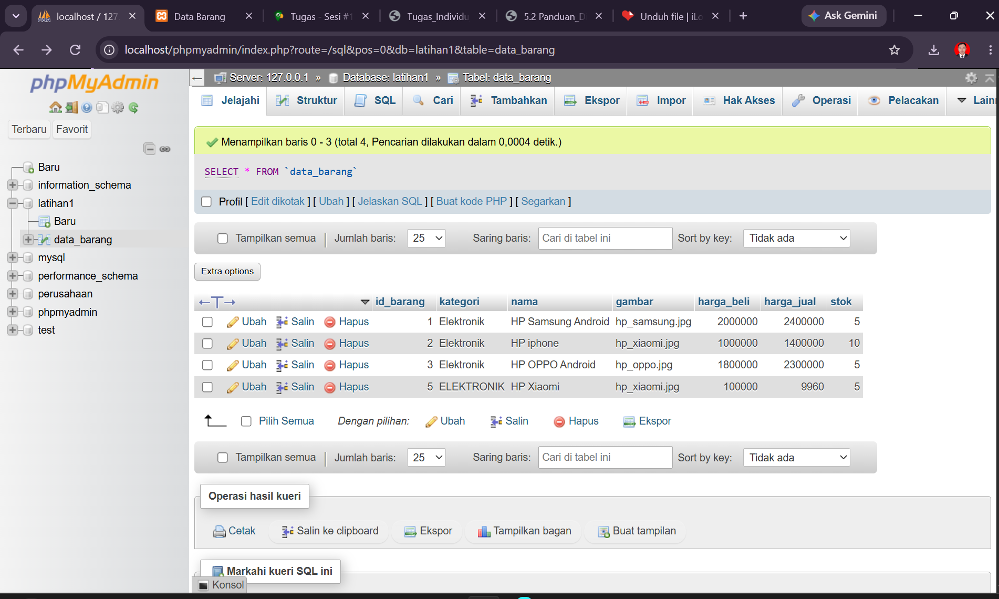
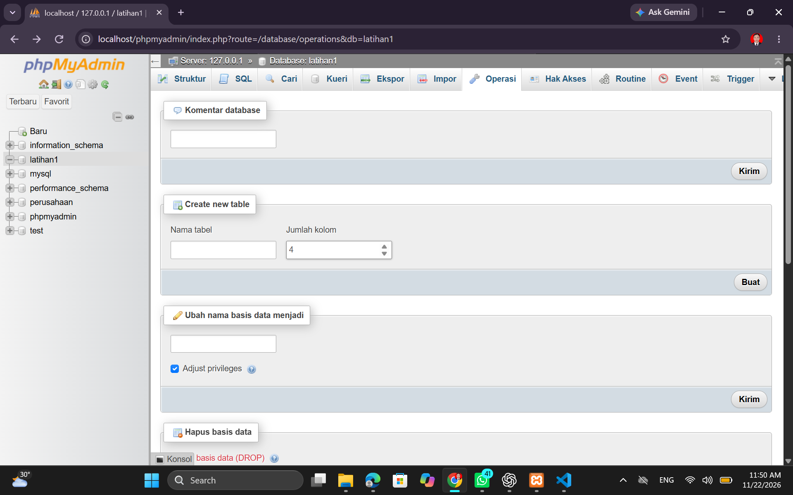
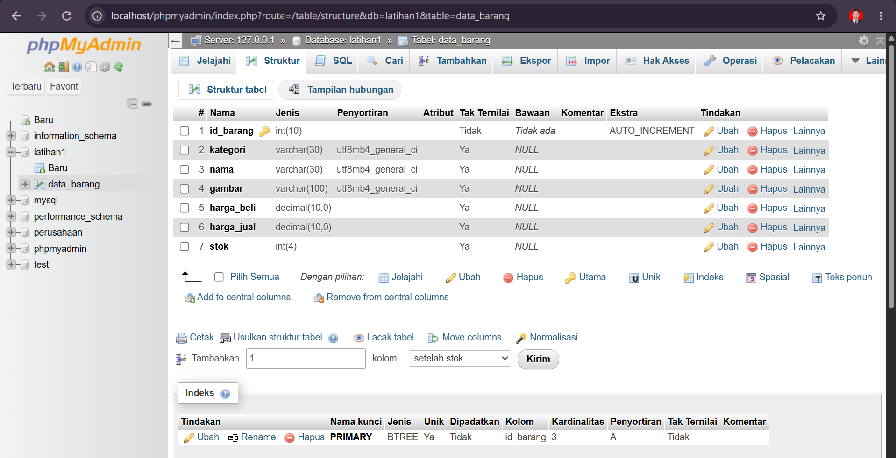
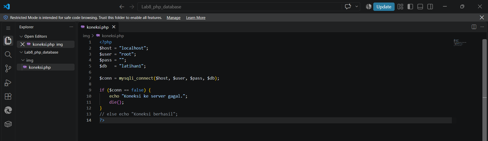
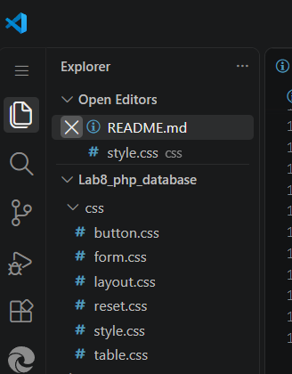

# LAPORAN PRAKTIKUM 8
# PHP DAN DATABASE MYSQL

**Nama:** Indra Pangestu
**NIM:** 312510008
**Kelas:** I253C
**Mata Kuliah:** Pemrograman Web  

---

## A. DESKRIPSI PRAKTIKUM

Praktikum 8 membahas penerapan PHP dan database MySQL dalam pembuatan aplikasi pengelolaan data barang sederhana. Praktikum ini menerapkan konsep CRUD (*Create, Read, Update, Delete*) yang terdiri dari proses menambahkan, menampilkan, mengubah, dan menghapus data barang.

Aplikasi ini menggunakan PHP sebagai bahasa pemrograman, MySQL sebagai database, serta HTML dan CSS untuk mengatur tampilan halaman website.

## B. TUJUAN PRAKTIKUM

1. Memahami konsep dasar database.
2. Memahami konsep dasar CRUD menggunakan PHP.
3. Membuat program CRUD sederhana menggunakan PHP.

## C. TOOLS YANG DIGUNAKAN

- XAMPP
- Visual Studio Code
- PHP
- MySQL
- phpMyAdmin
- Web Browser
- GitHub

---

# 1. PERSIAPAN PRAKTIKUM

### 1.1 Menjalankan XAMPP

XAMPP digunakan sebagai lingkungan pengembangan aplikasi berbasis PHP dan MySQL. Pada praktikum ini, layanan Apache dan MySQL dijalankan melalui XAMPP Control Panel. Apache berfungsi sebagai web server, sedangkan MySQL digunakan untuk mengelola database.

### 1.2 Mengakses phpMyAdmin

phpMyAdmin merupakan aplikasi berbasis web yang digunakan untuk mengelola database MySQL. Melalui phpMyAdmin, proses pembuatan database, tabel, serta pengelolaan data dapat dilakukan dengan lebih mudah.

---

# 2. MEMBUAT DATABASE

### 2.1 Database latihan1

Database yang digunakan dalam praktikum ini bernama `latihan1`. Database tersebut berfungsi sebagai tempat penyimpanan seluruh informasi barang yang dikelola melalui aplikasi.

### 2.2 Tabel data_barang

Di dalam database `latihan1` terdapat tabel `data_barang` yang digunakan untuk menyimpan informasi barang.

Tabel tersebut memiliki tujuh kolom, yaitu `id_barang`, `kategori`, `nama`, `gambar`, `harga_beli`, `harga_jual`, dan `stok`.

Kolom `id_barang` berfungsi sebagai identitas setiap barang dan menggunakan pengaturan Primary Key serta Auto Increment. Sementara itu, kolom lainnya digunakan untuk menyimpan informasi barang.

**Dokumentasi:**

### 2.3 Data Awal Barang

Data awal yang terdapat dalam tabel `data_barang` terdiri dari tiga barang elektronik, yaitu HP Samsung Android, HP Xiaomi Android, dan HP OPPO Android.

Setiap data memiliki informasi kategori, nama barang, gambar, harga beli, harga jual, serta jumlah stok. Data awal ini digunakan sebagai data pengujian dalam penerapan fitur CRUD.

---

# 3. KONEKSI DATABASE

### 3.1 Struktur Folder Project

Project praktikum disimpan dalam folder `Lab8_php_database` yang berada di dalam direktori `htdocs`. Folder tersebut menjadi direktori utama untuk seluruh file aplikasi, termasuk file PHP, CSS, gambar, dan dokumentasi.

Project dapat diakses melalui browser menggunakan alamat:

`http://localhost/labs/Lab8_php_database/`

### 3.2 File koneksi.php

File `koneksi.php` berfungsi menghubungkan aplikasi PHP dengan database MySQL. Koneksi menggunakan informasi host, username, password, dan nama database.

Fungsi `mysqli_connect()` digunakan untuk menghubungkan aplikasi dengan database `latihan1`. Apabila koneksi gagal, program akan menampilkan pesan kesalahan.

### 3.3 Hasil Pengujian Koneksi

Pengujian koneksi dilakukan untuk memastikan aplikasi PHP dapat terhubung dengan database MySQL. Hasil pengujian menunjukkan bahwa koneksi database dapat digunakan oleh aplikasi tanpa mengalami kesalahan.

---

# 4. MENAMPILKAN DATA BARANG (READ)

### 4.1 Folder index

Folder `index` berisi beberapa file PHP yang digunakan untuk mengelola proses penampilan data barang, yaitu `query.php`, `tabel.php`, dan `aksi.php`.

Pemisahan file tersebut membuat struktur program lebih terorganisasi karena setiap file memiliki fungsi masing-masing.

### 4.2 File query.php

File `query.php` berfungsi menjalankan perintah SQL SELECT untuk mengambil seluruh data barang dari tabel `data_barang`.

Data yang diperoleh dari database kemudian digunakan sebagai sumber informasi pada halaman utama aplikasi.

### 4.3 File aksi.php

File `aksi.php` berfungsi mengatur bagian aksi pada tabel, seperti tombol untuk mengubah dan menghapus data barang.

Keberadaan file ini membantu memisahkan bagian aksi dari tampilan tabel sehingga kode program lebih terstruktur.

### 4.4 File tabel.php

File `tabel.php` berfungsi menampilkan data barang dalam bentuk tabel HTML. Informasi yang ditampilkan meliputi gambar, nama barang, kategori, harga beli, harga jual, stok, dan bagian aksi.

### 4.5 File index.php

File `index.php` merupakan halaman utama aplikasi yang menghubungkan proses pengambilan data dengan tampilan tabel barang.

Melalui halaman ini, seluruh data barang yang tersimpan di dalam database dapat ditampilkan kepada pengguna.

### 4.6 Tampilan CSS

Tampilan website menggunakan CSS yang dipisahkan ke dalam beberapa file berdasarkan fungsinya. File tersebut meliputi `reset.css`, `layout.css`, `table.css`, `style.css`, `form.css`, dan `button.css`.

Penggunaan CSS bertujuan mengatur tata letak, tampilan tabel, formulir, serta tombol agar halaman website terlihat lebih rapi dan mudah digunakan.

### 4.7 Hasil Tampilan READ

Hasil penerapan fitur READ menunjukkan bahwa aplikasi berhasil mengambil dan menampilkan data barang dari database `latihan1`. Data barang ditampilkan dalam bentuk tabel pada halaman utama website.

**Dokumentasi:**

### 4.8 Gambar Barang

Gambar barang digunakan sebagai ilustrasi produk yang ditampilkan pada halaman utama aplikasi. Gambar yang digunakan terdiri dari HP Samsung, HP Xiaomi, HP OPPO, dan HP Vivo.

Seluruh gambar disimpan di dalam folder `gambar` pada direktori project. Nama file gambar disesuaikan dengan data yang terdapat pada kolom `gambar` di database.

**Dokumentasi:**

### 4.9 Menampilkan Gambar pada Tabel

Penampilan gambar pada tabel dilakukan melalui elemen HTML `` yang terdapat pada file `index/tabel.php`. Nama gambar diambil dari kolom `gambar` pada database.

Pengaturan ukuran dan tampilan gambar dilakukan melalui CSS agar gambar terlihat proporsional dan sesuai dengan ukuran kolom tabel.

**Dokumentasi:**

### 4.10 Hasil Tampilan READ dengan Gambar

Setelah proses penyesuaian selesai, halaman utama aplikasi menampilkan data barang beserta gambar masing-masing produk. Dengan demikian, informasi barang dapat dilihat secara lebih jelas dan mudah dikenali.

**Dokumentasi:**

---

# 5. MENAMBAHKAN DATA BARANG (CREATE)

### 5.1 File tambah.php

Fitur CREATE digunakan untuk menambahkan data barang baru ke dalam database. File `tambah.php` berfungsi sebagai halaman utama yang mengakses formulir penambahan barang.

**Dokumentasi:**

### 5.2 Folder tambah

Folder `tambah` berisi file `form.php` dan `proses.php`. Kedua file tersebut memiliki fungsi berbeda dalam proses penambahan data barang.

File `form.php` digunakan untuk menampilkan formulir, sedangkan `proses.php` digunakan untuk mengolah data yang dikirimkan melalui formulir.

**Dokumentasi:**

### 5.3 Formulir Tambah Barang

Formulir tambah barang berisi beberapa informasi yang diperlukan, yaitu nama barang, kategori, gambar, harga beli, harga jual, dan stok.

Formulir tersebut menjadi media input bagi pengguna untuk memasukkan informasi barang baru ke dalam aplikasi.

**Dokumentasi:**

### 5.4 Proses Penyimpanan Data

Proses penyimpanan data dilakukan melalui file `proses.php`. Data yang dikirimkan dari formulir diproses menggunakan perintah SQL INSERT sehingga informasi barang dapat tersimpan pada tabel `data_barang`.

### 5.5 Hasil Penambahan Data

Pengujian fitur CREATE dilakukan dengan menambahkan barang HP Vivo Android. Setelah data disimpan, informasi barang tersebut muncul pada tabel halaman utama.

Hasil tersebut menunjukkan bahwa proses penambahan data berhasil dilakukan dan data baru telah tersimpan di dalam database.

**Dokumentasi:**

---

# 6. MENGUBAH DATA BARANG (UPDATE)

### 6.1 File ubah.php

Fitur UPDATE digunakan untuk mengubah informasi barang yang sudah tersimpan di dalam database.

File `ubah.php` berfungsi mengambil data barang berdasarkan `id_barang` yang dipilih. Data tersebut kemudian ditampilkan kembali pada formulir perubahan.

**Dokumentasi:**

### 6.2 Folder ubah

Folder `ubah` berisi file `form.php` dan `proses.php`. File `form.php` digunakan untuk menampilkan formulir perubahan data, sedangkan `proses.php` digunakan untuk memproses perubahan yang dilakukan pengguna.

**Dokumentasi:**

### 6.3 Formulir Ubah Barang

Formulir ubah barang menampilkan informasi barang yang sebelumnya telah tersimpan di database. Informasi tersebut meliputi nama barang, kategori, harga beli, harga jual, dan stok.

Pengguna dapat memperbarui informasi tersebut sesuai kebutuhan.

**Dokumentasi:**

### 6.4 Proses Update Data

Proses perubahan data dilakukan melalui file `proses.php` dengan menggunakan perintah SQL UPDATE.

Perubahan dilakukan berdasarkan `id_barang`, sehingga hanya data barang yang dipilih yang akan diperbarui. Selain informasi barang, gambar juga dapat diperbarui apabila terdapat gambar baru yang dipilih.

**Dokumentasi:**

### 6.5 Tombol Ubah pada Tabel

Tombol Ubah ditampilkan pada bagian aksi di halaman utama. Tombol tersebut digunakan untuk mengakses formulir perubahan data berdasarkan ID barang yang dipilih.

**Dokumentasi:**

### 6.6 Hasil Pengubahan Data

Pengujian UPDATE dilakukan dengan memilih salah satu barang dan mengubah informasi yang terdapat pada formulir. Setelah perubahan disimpan, informasi barang pada tabel halaman utama diperbarui sesuai dengan data terbaru.

Hasil tersebut menunjukkan bahwa proses UPDATE berhasil dijalankan.

**Dokumentasi:**

---

# 7. MENGHAPUS DATA BARANG (DELETE)

### 7.1 File hapus.php

Fitur DELETE digunakan untuk menghapus data barang yang sudah tersimpan di dalam database.

File `hapus.php` menerima nilai `id_barang` dari URL dan menjalankan perintah SQL DELETE untuk menghapus data berdasarkan ID tersebut.

**Dokumentasi:**

### 7.2 Tombol Hapus pada Tabel

Tombol Hapus ditampilkan pada bagian aksi di halaman utama. Tombol tersebut digunakan untuk memilih data barang yang akan dihapus.

Selain itu, terdapat pesan konfirmasi untuk memastikan bahwa pengguna benar-benar ingin menghapus data yang dipilih.

**Dokumentasi:**

### 7.3 Hasil Penghapusan Data

Pengujian DELETE dilakukan dengan memilih salah satu barang, kemudian melakukan konfirmasi penghapusan.

Setelah proses penghapusan berhasil, data barang yang dipilih tidak lagi ditampilkan pada tabel halaman utama. Hal ini menunjukkan bahwa proses DELETE berhasil dilakukan.

---

# 8. HASIL PRAKTIKUM

Berdasarkan seluruh tahapan praktikum yang telah dilakukan, aplikasi pengelolaan data barang berhasil dibuat menggunakan PHP dan MySQL dengan menerapkan empat operasi CRUD, yaitu:

1. **Create**, yaitu proses menambahkan data barang baru ke dalam database.
2. **Read**, yaitu proses menampilkan data barang yang tersimpan di dalam database beserta gambar produk.
3. **Update**, yaitu proses mengubah informasi barang yang sudah tersimpan.
4. **Delete**, yaitu proses menghapus data barang berdasarkan ID.

Melalui praktikum ini, penerapan PHP dan MySQL dalam pengelolaan database dapat dipahami melalui pembuatan aplikasi CRUD sederhana. Seluruh hasil pengerjaan disimpan dalam repository GitHub dengan nama `Lab8Web`.